<p align="center">
  <picture>
    <source media="(prefers-color-scheme: dark)" srcset="public/brand/Logo White.png">
    
  </picture>
</p>

<p align="center"><strong>Finance, without the noise.</strong></p>

<p align="center">
  A monochrome finance workspace for small businesses — invoicing with PayPal reconciliation, a transaction ledger,
  expenses, budgets, cash-flow forecasting, evidence-based recurring-charge detection, and a grounded finance Copilot,
  all on one deterministic local ledger.
</p>

<p align="center">
  <a href="#screens">Screens</a> ·
  <a href="#quick-start">Quick start</a> ·
  <a href="#architecture">Architecture</a> ·
  <a href="#configuration">Configuration</a> ·
  <a href="#security">Security</a> ·
  <a href="docs/SECURITY.md">Operations guide</a>
</p>

> **Demo build.** MERGIN is an MVP that runs on your machine. Every invoice, transaction, expense, budget, and Sentinel
> signal is local SQLite data. PayPal, email, and model calls happen only when you supply real credentials, and demo
> mode is labelled everywhere. Nothing here pretends an action succeeded when it did not.

## Screens

### Sign in

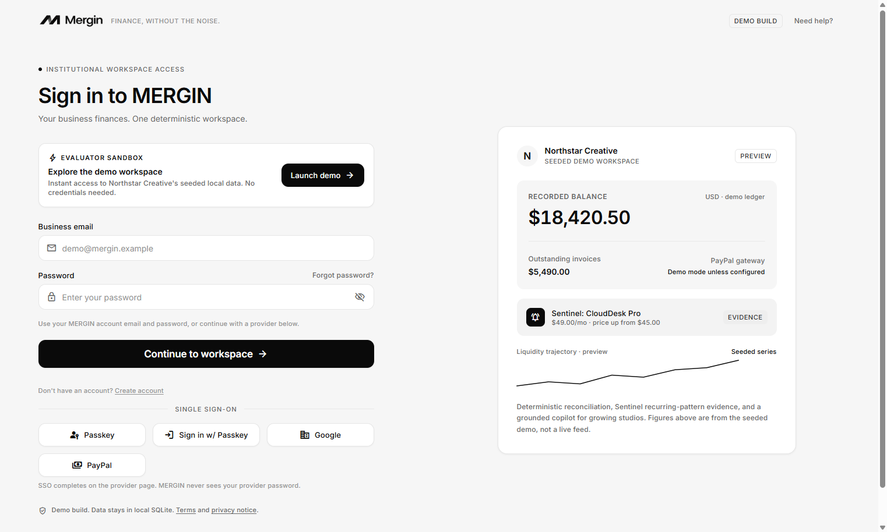

One-click demo entry, plus email/password, Google, PayPal, and passkey sign-in when the matching providers are
configured. The signed HTTP-only `mergin_session` cookie is the only session state kept by the browser.

### Overview

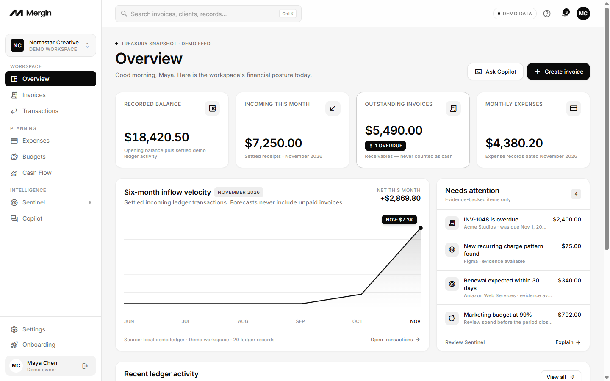

Treasury snapshot for the seeded Northstar Creative workspace: recorded balance, incoming month-to-date, outstanding
receivables, spend, budget posture, recent activity, and Sentinel signals. Dashboard totals reconcile exactly with the
ledger beneath them.

### Invoices

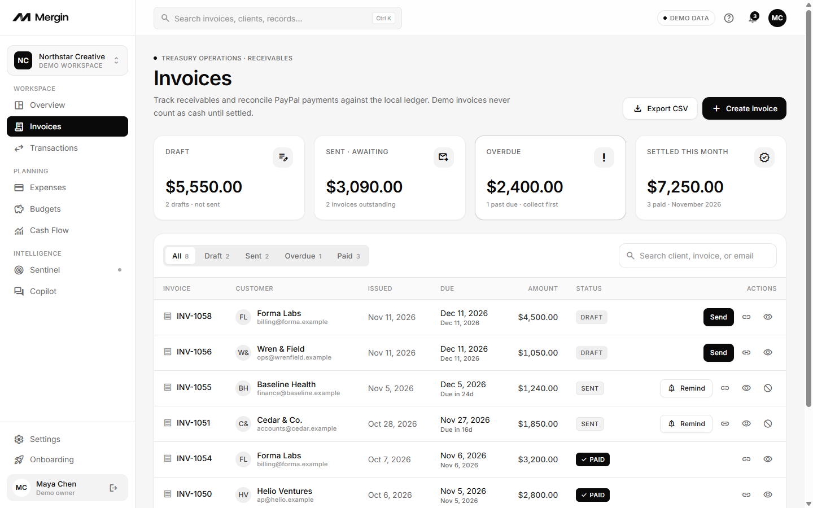

Invoice management with status, issue and due dates, totals, search, status filters, and CSV export. Amounts are stored
as integer USD cents; formatting happens only at the edge.

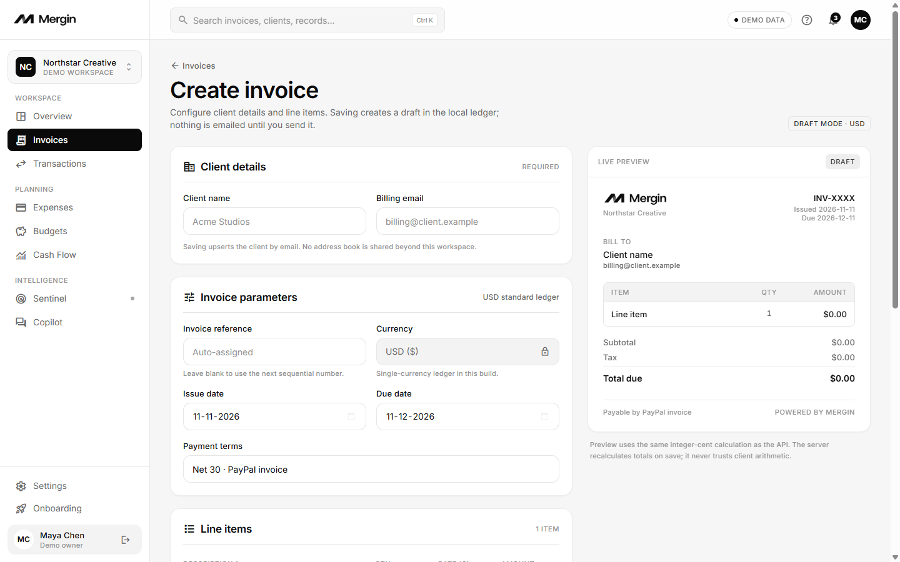

The create screen renders a live draft preview. The server recalculates subtotal, tax, discount, and total using integer
math — it never trusts browser arithmetic. Saving creates a draft; nothing is emailed until you send it.

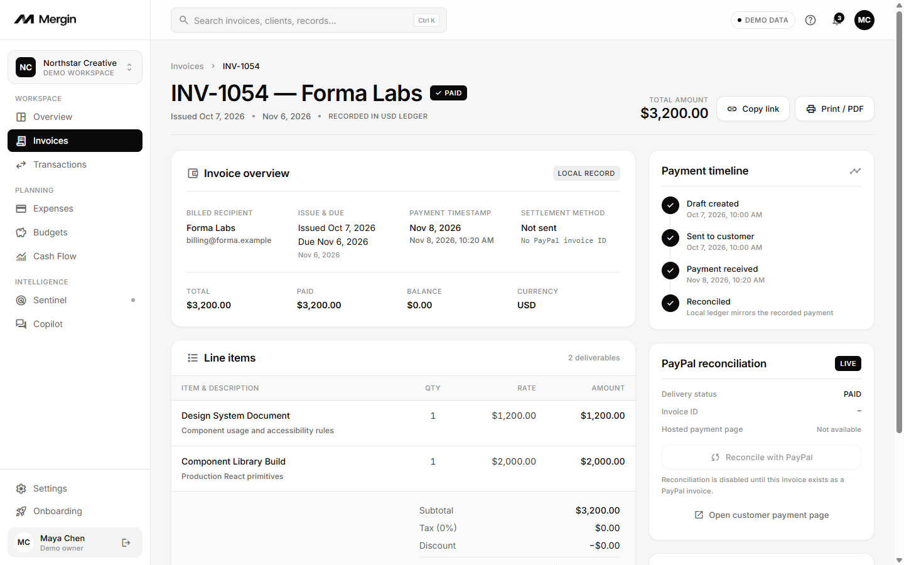

Invoice detail combines line items, the payment timeline, audit events, and send/remind/cancel actions. Payment status
changes only from server-side evidence or a verified PayPal webhook, never from a browser redirect.

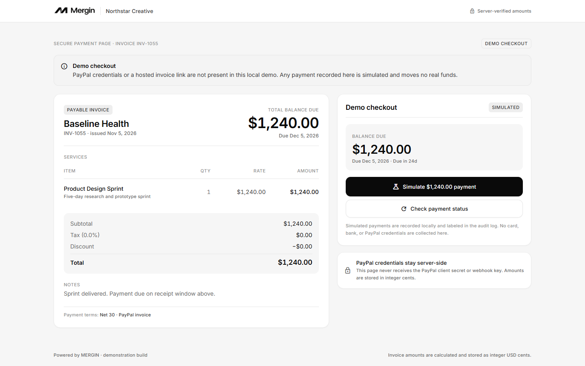

Customers open one invoice through a random public token URL. Returning from PayPal shows a processing state and polls
the backend until reconciliation lands. A clearly labelled demo payment is available for local testing and moves no
real funds.

### Ledger and planning

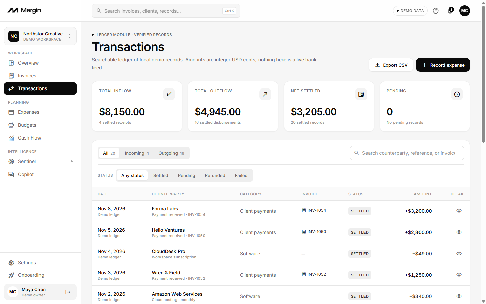

A searchable ledger of settled, pending, refunded, and failed records with inflow/outflow totals, invoice links, and
CSV export.

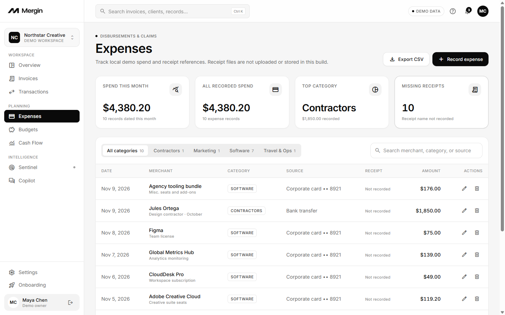

Expense tracking by category, source, and receipt reference. Receipt files themselves are not uploaded or stored in
this build, and the UI says so.

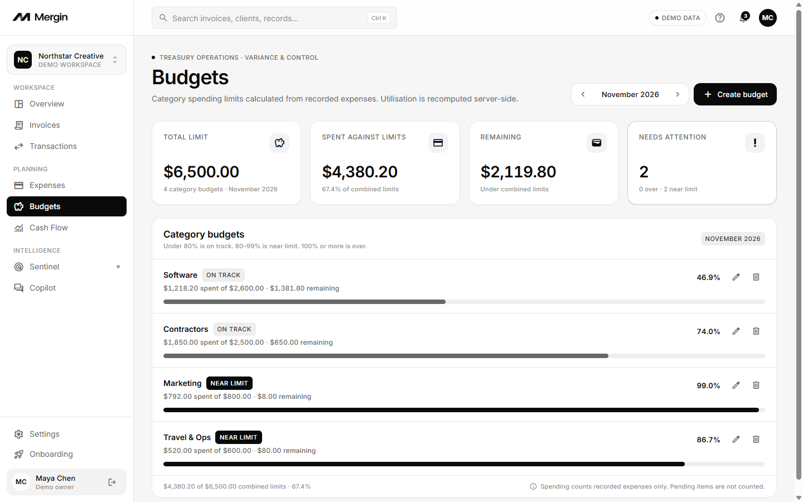

Monthly category limits with utilisation recomputed server-side from recorded expenses: under 80% is on track, 80–99%
is near limit, and 100% or more is over.

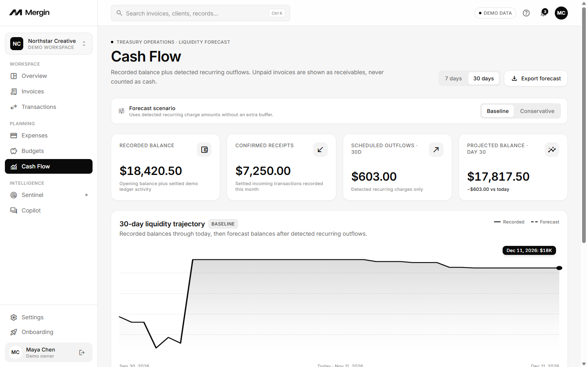

Recorded balance plus detected recurring outflows across 7- and 30-day horizons. Unpaid invoices appear as receivables
and are never counted as guaranteed cash. Baseline and conservative scenarios are calculated on the server.

### Intelligence

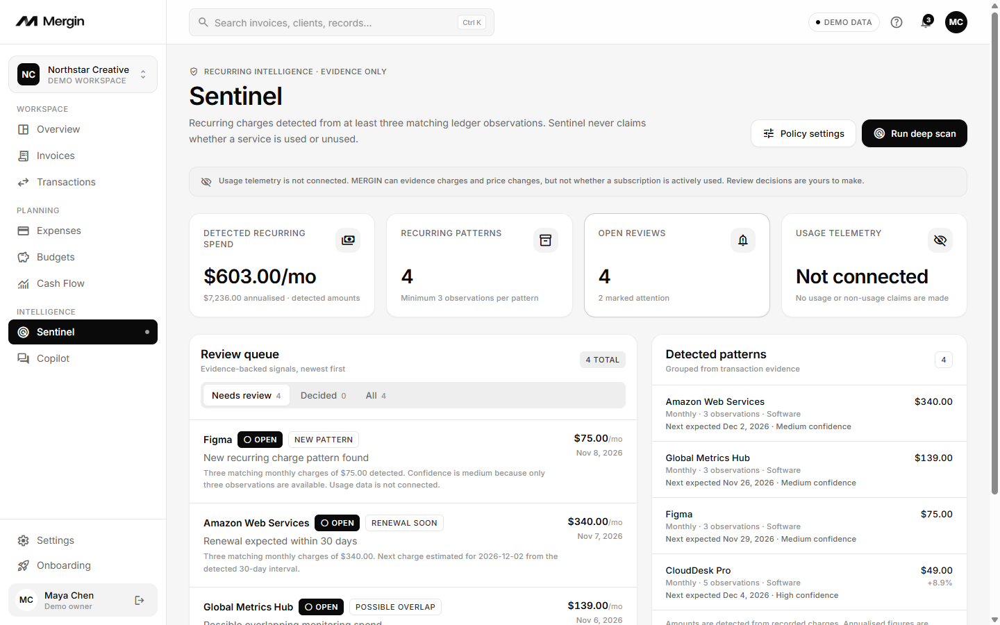

Sentinel reports recurring charges only when at least three matching ledger observations exist. It surfaces confidence,
price changes, and overlapping vendors — and states plainly that usage telemetry is not connected, so it never claims a
subscription is used or unused. Review decisions are the user's to make and are stored with an audit trail.

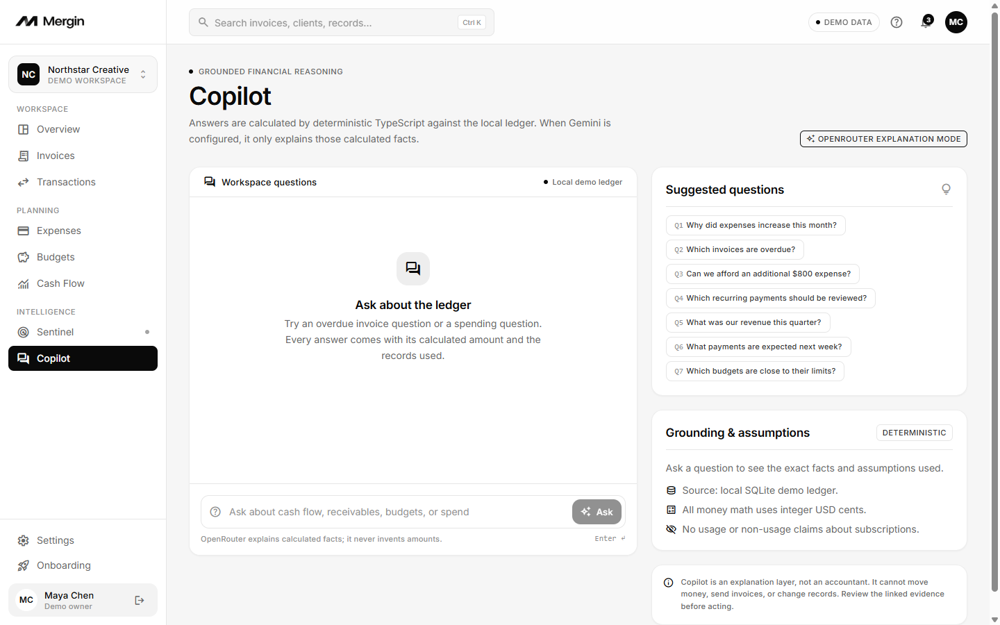

The Copilot calculates every amount, count, and evidence link in deterministic TypeScript first. OpenRouter (or the
legacy Gemini path) may only phrase those facts; with no key, a deterministic local answer is returned instead.

### Settings

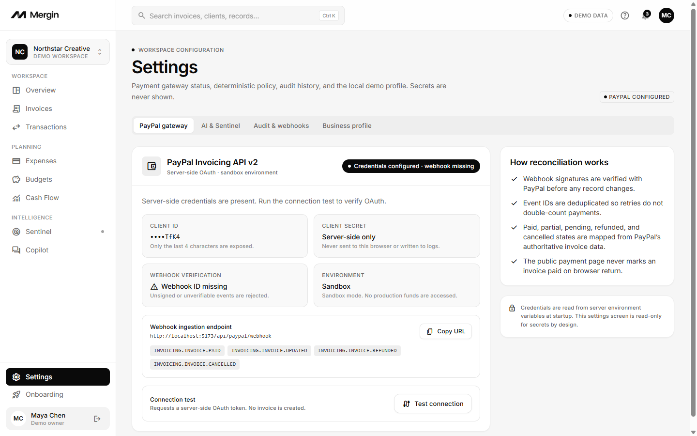

Settings covers PayPal gateway status, the webhook endpoint and subscribed events, AI and Sentinel policy, audit
history, and the local demo profile. Vendor secrets stay in the server environment and are never rendered.

## What's inside

- **Invoicing** — drafts, line items, tax and discount, PDF generation, email delivery, PDF print, hosted PayPal
  invoices, reminders, cancellation, and a public payment page.
- **PayPal reconciliation** — server-side OAuth, Invoicing API v2, signature-verified webhooks, deduplicated events,
  and explicit mapping for partial, pending, paid, refunded, and cancelled states.
- **Ledger and planning** — transactions, expenses, monthly category budgets, and 7/30-day cash-flow forecasts.
- **Sentinel** — recurring-charge evidence with a minimum of three observations, price-change and overlap detection,
  and an explicit "usage telemetry not connected" statement.
- **Copilot** — deterministic facts with optional model phrasing. It cannot move money, send invoices, or change records.
- **Trustworthy states** — missing credentials produce truthful `409`/`503` responses and matching UI copy. No fake
  success toasts, no invoice marked paid by a browser return.
- **Monochrome design system** — achromatic surfaces, text, and iconography; Inter with tabular numerals for money; no
  colored status chips and no chart library.
- **Production groundwork** — security headers and CSP, rate limiting, same-origin write guard, workspace indexes,
  health check, route-level code splitting, CI, and weekly dependency updates.

## Stack

| Layer | Choice |
| --- | --- |
| Frontend | React 19, TypeScript, React Router 7, Vite 7, Tailwind CSS built locally |
| Backend | Node.js, Express 5, Zod validation |
| Persistence | `node:sqlite` with a typed repository layer; one SQLite file |
| Domain | Shared TypeScript types, integer money math, dates, and Sentinel detection |
| Documents | `pdf-lib` for invoice PDFs, `nodemailer` for SMTP delivery |
| AI | Deterministic Copilot core; optional OpenRouter or Gemini phrasing (server-only) |
| Tests | Vitest, Supertest |
| Design | Achromatic system from `Stitch Screens/achromatic_financial_architecture/DESIGN.md` |

Node.js **22.5+** is required for the built-in `node:sqlite` module. CI uses Node 22.

## Quick start

```bash
npm install
npm run db:reset      # create and seed the local SQLite database
npm run dev           # API on :3001, Vite on :5173
```

Open <http://localhost:5173> and either:

- click **Launch demo**, or
- sign in with `demo@mergin.example` / `mergin-demo`.

The Vite dev server proxies `/api` to `http://localhost:3001`.

### Scripts

| Command | What it does |
| --- | --- |
| `npm run dev` | Runs API (`tsx watch`) and Vite together |
| `npm run dev:api` | API only, `http://localhost:3001` |
| `npm run dev:web` | Vite only, `http://localhost:5173` |
| `npm run db:reset` | Drops and reseeds `dev.db` |
| `npm run db:seed` | Seeds an empty database without dropping it |
| `npm run typecheck` | TypeScript checks for the app and server |
| `npm run lint` | ESLint |
| `npm test` | Vitest suite |
| `npm run build` | Typecheck, then Vite production build to `dist/` |
| `npm start` | Runs the Express server; serves `dist/` when it has been built |

## Architecture

MERGIN is a single-repo TypeScript application. The React SPA renders the workspace; the Express API owns every
decision that matters.

```text
React 19 SPA (Vite)
  │  JSON over /api — Vite proxy in development
  ▼
Express 5 + Zod validation
  ├── signed HTTP-only session cookie (mergin_session)
  ├── node:sqlite — typed repositories, workspace-scoped indexes
  ├── PayPal Invoicing API v2 — server OAuth, verified + deduplicated webhooks
  ├── SMTP + pdf-lib — invoice HTML body and PDF attachment
  └── Copilot — deterministic facts, optional model phrasing
```

- **One ledger, integer money.** `shared/money.ts` owns parsing, arithmetic, and formatting. Every stored amount is an
  integer in minor units; floating-point money math is never used.
- **Server-authoritative.** Invoice totals, budget utilisation, cash-flow forecasts, PayPal status, and payment state
  are computed or confirmed on the server.
- **Shared domain.** `shared/` holds the types, money helpers, date helpers, and Sentinel detection used by both sides.
- **Truthful failure.** Missing provider configuration returns explicit `409`/`503` responses and matching UI copy
  rather than simulated success.
- **Code-split frontend.** Routes load on demand; React, React DOM, and React Router live in a separate vendor chunk.

### Project layout

```text
server/            Express API, SQLite schema/repos, PayPal, email, Copilot, webhook, seed
shared/            Domain types, money math, dates, deterministic Sentinel detection
src/               React app, pages, components, API client, design tokens
public/brand/      MERGIN logo and derived icons (source: Logo.png)
tests/             Vitest + Supertest suites
docs/              Screenshots, security guide, implementation status
Stitch Screens/    Original Stitch exports and DESIGN.md (reference only — not the app)
```

## Routes

| Route | Screen |
| --- | --- |
| `/login` | Sign in |
| `/onboarding/business` | Business profile setup |
| `/onboarding/paypal` | PayPal Sandbox connection |
| `/app` | Overview dashboard |
| `/app/invoices` | Invoice management |
| `/app/invoices/new` | Create invoice |
| `/app/invoices/:id` | Invoice detail and payment timeline |
| `/pay/:publicToken` | Public customer payment page |
| `/app/transactions` | Transaction ledger |
| `/app/expenses` | Expense management |
| `/app/budgets` | Budget management |
| `/app/cash-flow` | Cash-flow analytics |
| `/app/sentinel` | Sentinel recurring intelligence |
| `/app/sentinel/:id` | Sentinel review detail |
| `/app/copilot` | Finance Copilot |
| `/app/settings` | Settings and integrations |

The supplied Stitch pack contains 15 screens; the Sentinel review detail screen was designed and built to match the
same achromatic system. The archived exports in `Stitch Screens/` are visual reference only — editing them does not
change the running app.

## Configuration

Copy `.env.example` to `.env` and fill in what you have. Every value is optional in development; with none set the app
runs in a clearly labelled local demo mode.

```bash
cp .env.example .env
```

| Variable | Purpose |
| --- | --- |
| `NODE_ENV` | `development` (default) or `production`. Production also requires `SESSION_SECRET` and `APP_BASE_URL` |
| `PORT` | API port (default `3001`) |
| `TRUST_PROXY` | Number of reverse proxies in front of the API. Set `1` behind nginx/Caddy/a PaaS edge |
| `APP_BASE_URL` | Public origin used in payment links and OAuth redirects (default `http://localhost:5173`) |
| `DATABASE_URL` | SQLite location (default `file:./dev.db`) |
| `SESSION_SECRET` | Cookie signing secret. Required in production; generate with `openssl rand -hex 32` |
| `SUPABASE_URL` / `SUPABASE_ANON_KEY` | Supabase project URL and anon key for email/password auth |
| `SUPABASE_SERVICE_ROLE_KEY` | Server-only admin key. Never send it to the browser |
| `GOOGLE_CLIENT_ID` / `GOOGLE_CLIENT_SECRET` | Google OAuth client. Paste the same pair into Supabase |
| `PAYPAL_ENV` | `sandbox` (default) or `live` |
| `PAYPAL_CLIENT_ID` / `PAYPAL_CLIENT_SECRET` | Server-side PayPal OAuth. Never exposed to the browser |
| `PAYPAL_WEBHOOK_ID` | Webhook ID used to verify PayPal signatures |
| `PUBLIC_WEBHOOK_BASE_URL` | Optional public HTTPS origin for webhooks; falls back to `APP_BASE_URL` |
| `SMTP_HOST` / `SMTP_PORT` | SMTP server and port (default port `587`) |
| `SMTP_SECURE` | `true` for TLS on connect (port 465); `false` for STARTTLS (port 587) |
| `SMTP_USER` / `SMTP_PASS` | SMTP credentials |
| `SMTP_FROM` | From address used for invoice email |
| `OPENROUTER_API_KEY` / `OPENROUTER_MODEL` | Copilot explanation provider |
| `GEMINI_API_KEY` / `GEMINI_MODEL` | Legacy Copilot provider, kept until the OpenRouter migration completes |

`.env` is ignored by git. `.env.example` documents names and safe defaults only; it contains no secrets.

### PayPal setup

1. Sign in at <https://developer.paypal.com/dashboard/> and switch to **Sandbox**.
2. Open **Apps & Credentials → Create App**, name it (for example `MERGIN Sandbox`), and create it.
3. Copy the **Client ID** and **Secret** into `.env`.
4. Open the app's **Webhooks** tab and add `<PUBLIC_WEBHOOK_BASE_URL or APP_BASE_URL>/api/paypal/webhook`.
5. Select the invoice events the server reconciles: `INVOICING.INVOICE.PAID`, `UPDATED`, `REFUNDED`, `CANCELLED`,
   `CREATED`, `SENT`, and `SCHEDULED`.
6. Copy the generated **Webhook ID** into `PAYPAL_WEBHOOK_ID`.
7. Restart the API and use **Settings → Integrations → Test connection** to verify OAuth.

For **Log in with PayPal**, enable the feature on the same app and set the return URL to
`${APP_BASE_URL}/api/auth/paypal/callback`. PayPal also asks for privacy-policy and user-agreement URLs. Without the
feature enabled, the PayPal button returns a provider error; no local session is created.

Localhost webhooks are not reachable from PayPal. Use a tunnel (for example `ngrok http 3001`) and set
`PUBLIC_WEBHOOK_BASE_URL` to the tunnel's HTTPS origin while testing.

### Email setup

Set `SMTP_HOST`, `SMTP_FROM`, and the matching credentials. Sending an invoice then renders a formatted PDF on the
server and emails it to the customer's billing address with an HTML body and PDF attachment. If SMTP is not configured,
sending falls back to PayPal when available, otherwise to demo mode — which states that no email was delivered and no
PayPal invoice was created.

### Identity setup

Email/password, Google OAuth, PayPal sign-in, passkeys (WebAuthn), self-service sign-up, and password reset are wired
through the server. **Launch demo** never needs credentials.

**Supabase**

1. Create a project at <https://supabase.com/dashboard>.
2. Copy the project URL, anon key, and service-role key from **Project Settings → API** into `.env`.
3. Under **Authentication → URL Configuration**, set the site URL to `APP_BASE_URL` and add
   `${APP_BASE_URL}/api/auth/google/callback` plus the production origin as redirect URLs.
4. Enable the Email and Google providers under **Authentication → Providers**.
5. Self-service sign-up and password reset work once Supabase is configured.

The service-role key bypasses row-level security. It belongs only in the server environment.

**Google OAuth**

1. In <https://console.cloud.google.com/>, create or pick a project.
2. Configure the **OAuth consent screen** as an External app with the `email` and `profile` scopes.
3. Create an **OAuth client ID → Web application**.
4. Add `https://<project-ref>.supabase.co/auth/v1/callback` as the authorised redirect URI, and add
   `http://localhost:5173` plus the production origin as authorised JavaScript origins.
5. Copy the client ID and secret into `.env` and into **Supabase → Authentication → Providers → Google**.

**Passkeys**

Passkeys use the WebAuthn API with ES256/P-256 credentials, stored locally per user. Register and authenticate via
`/auth/passkey/register/*` and `/auth/passkey/authenticate/*`. Modern browsers only; there is no legacy fallback.

### Copilot behaviour

`@google/genai` and the OpenRouter client are imported only on the server. All amounts, counts, and evidence are
calculated in TypeScript first. A configured model may only explain those facts; without a key, a deterministic local
answer is returned. The Copilot cannot move money, send invoices, or change records.

## Demo data

`npm run db:reset` seeds one coherent workspace — Northstar Creative:

- Opening balance `$15,215.50`, current recorded balance `$18,420.50`
- Incoming this month `$7,250.00`
- Outstanding `$5,490.00`, including one overdue invoice
- Expenses this month `$4,380.20`
- 8 invoices, 20 transactions, 10 expenses, 4 budgets, 4 recurring patterns, 4 Sentinel reviews

All data is local and resettable from **Settings → Business profile → Reset demo data**. Resetting never calls PayPal
and never sends email.

## Security

Controls active in every environment:

- Security headers and a Google Fonts-aware CSP; `x-powered-by` disabled.
- Global API rate limiting and a stricter limit on failed sign-ins.
- HMAC-signed, `HttpOnly`, `SameSite=Lax` session cookies, `Secure` in production.
- A same-origin guard on state-changing API methods, with `Cache-Control: no-store` on `/api`.
- Zod validation at every trust boundary, scrypt password hashes, and parameterized SQL only.
- CSV formula-injection escaping and email header/attachment filename sanitization.
- PayPal webhooks fail closed without credentials and are signature-verified and deduplicated.
- A production startup guard that refuses to run without `SESSION_SECRET` and `APP_BASE_URL`.
- `/api/health` runs a real database check and returns `503` when SQLite is unavailable.

TLS termination, encrypted database volumes, backups, log retention, alerting, and SPF/DKIM/DMARC are operator
responsibilities. See [`docs/SECURITY.md`](docs/SECURITY.md) for the deployment checklist and data-at-rest notes.

## Testing and CI

```bash
npm run typecheck
npm run lint
npm test
npm run build
```

The suite contains **52 tests across 11 files**, covering integer money math, CSV escaping, Sentinel detection,
PayPal status mapping and signature verification, webhook idempotency and fail-closed behaviour, budget utilisation,
security headers and origin checks, auth provisioning, invoice API validation, email header sanitization, and PDF
generation with Unicode and control characters.

GitHub Actions runs typecheck, lint, tests, and build on every push and pull request. Dependabot checks npm and GitHub
Actions weekly.

## Known limits

- Provider sign-in verifies the external identity once, then issues a signed 7-day MERGIN session cookie.
- Self-service sign-up, password reset, and Supabase email/password auth require Supabase credentials.
- Passkeys require WebAuthn support; there is no fallback for legacy browsers.
- Without PayPal or SMTP configured, invoice send/remind are demo actions that explicitly say what did not happen.
- Receipt files are referenced by name only; uploads are not stored.
- The public payment page only opens a genuine PayPal URL when the server created a real hosted invoice. Otherwise it
  offers a clearly labelled local simulation.
- SQLite stores business data in plaintext on disk. Disk encryption, backups, TLS, and email DNS records are deployment
  tasks, not app features.
- CI verifies the build; deployment automation is not included.

## Documentation

- [`docs/SECURITY.md`](docs/SECURITY.md) — security controls, deployment checklist, data-at-rest guidance
- [`docs/IMPLEMENTATION_STATUS.md`](docs/IMPLEMENTATION_STATUS.md) — screen coverage, API routes, feature status
- [`AGENTS.md`](AGENTS.md) — repository guidance for agents
- [`.env.example`](.env.example) — environment variable reference
